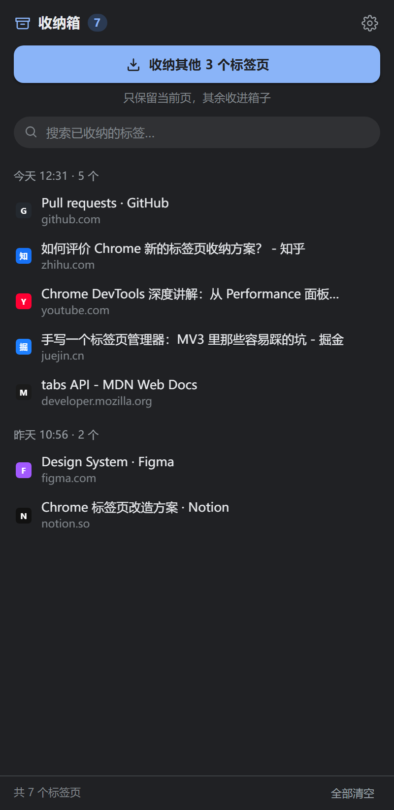

# 标签收纳箱

一个给 Chrome 156+ 用的 MV3 扩展：**一键关掉当前窗口除当前页以外的所有标签页，把它们收进侧边栏的「箱子」里；需要时点一下，原样放回来。**

标签页本身是内存大户。这个扩展的思路不是「管理」标签页，而是把暂时不用的那些**收起来放着**——不占标签栏、不占内存，用的时候再点开，和以前习惯的「点标签页」几乎一样。


## 交互

点扩展图标 → 右侧滑出收纳箱（也可以把图标固定到工具栏）。

```
┌─ 收纳箱 7 ──────────────── ⚙ ┐
│  ⏏  收纳其他 3 个标签页         │  ← 一键收走，只留当前页
│  🔍 搜索已收纳的标签…           │
│  今天 12:29 · 4 个              │
│   ▸ 🟦 如何评价 Chrome 新的…     │
│       zhihu.com                 │
│   ▸ 🐙 Pull requests · GitHub   │
│  昨天 10:54 · 2 个              │
└────────────────────────────────┘
```

- **收纳**：只保留当前标签页，其余全部关闭并落盘。按钮上实时显示「还能收几个」。
- **取回**：点条目 → 在当前窗口按原来的位置打开 → 条目从箱里消失，底部浮出「已打开 · 撤销」，9 秒内可反悔（会关掉刚打开的标签页并把条目放回原位）。
- **整批操作**：鼠标移到批次标题上，出现「全部打开 / 删除」。
- **搜索**：按 `/` 聚焦搜索框，按标题或网址过滤。
- **键盘**：`↑` `↓` 在条目间移动，`Enter` 打开，`Delete` 移出箱子。
- **快捷键**：`Alt+Shift+P` 随时收纳当前窗口其他标签页（可在 `chrome://extensions/shortcuts` 改）。
- **角标**：工具栏图标上的数字就是箱内条目数，这是它平时唯一的存在感。

深色模式跟随系统：



## 安装（加载已解压）

1. 打开 `chrome://extensions`，右上角开启 **开发者模式**。
2. 点 **加载已解压的扩展程序**，选择本目录（含 `manifest.json` 的那一层）。
3. 建议点扩展卡片上的「固定」，把图标放到工具栏。

> Chrome 137 起，正式版 Chrome 已移除 `--load-extension` 命令行开关，只能这样手动加载；Chrome for Testing 仍支持命令行。

## 行为细节

| 场景 | 行为 |
| --- | --- |
| 收纳范围 | 仅当前窗口；固定标签页、正在播放声音的标签页默认也会被收走（可在设置里改为跳过） |
| 空白新标签页 | 直接关闭，不占箱子位置 |
| 重复网址 | 箱内已有同一 URL 时只关不存，避免堆积 |
| 恢复位置 | 尽量放回原来的标签顺序位置；原来固定的仍以固定形式打开 |
| 撤销 | 收纳之外的每个操作（取回、删除、整批打开、清空）都能撤销一次，记录存在 `chrome.storage.session`，重启浏览器后失效 |
| 容量 | 最多 5000 条，超出后从最旧的批次末尾开始清 |
| 清空 | 需要确认；清空后仍可撤销 |

## 权限与隐私

| 权限 | 用途 |
| --- | --- |
| `tabs` | 读取标签页的地址、标题、图标，关闭和创建标签页 |
| `storage` | 把收纳内容存在本机 |
| `sidePanel` | 显示右侧收纳箱 |
| `favicon` | 没有图标时用 Chrome 缓存的网站图标兜底 |

没有任何网络请求，数据只写在 `chrome.storage.local`，不联网、不上传、不注入页面。

## 项目结构

```
manifest.json              MV3 清单（minimum_chrome_version: 156）
src/background.js          service worker：收纳 / 取回 / 撤销 / 徽标 / 快捷键
src/lib/store.js           本地存储、数据归一化、容量上限
src/sidepanel/panel.html   侧边栏结构
src/sidepanel/panel.css    样式（浅色 / 深色）
src/sidepanel/panel.js     侧边栏交互
icons/                     16/32/48/128 图标
tools/make-icons.ps1       重新生成图标
tools/browser-test.mjs     真机集成测试 + 截图
tools/cdp.mjs              CDP 调试小工具
docs/                      界面截图
```

## 开发与验证

所有逻辑都在 `src/` 下，无构建步骤，改完在 `chrome://extensions` 点扩展卡片上的刷新按钮即可。

真机测试（会启动一个临时配置目录的无头 Chrome，通过 CDP 的 `Extensions.loadUnpacked` 装入扩展，跑完自动清理）：

```powershell
node tools/browser-test.mjs
```

覆盖：扩展加载、侧边栏渲染、收纳（关闭数量 / 保存地址与标题）、点击恢复、撤销恢复、整批打开、撤销整批、设置保存、空箱状态、页面无 JS 报错，并输出 `docs/panel-*.png`。

> 说明：Chrome 的崩溃上报进程在受限环境里无法启动，这个脚本需要在完全权限下运行。

## 已知限制

- 只处理**当前窗口**；多窗口要分别收纳。
- 侧边栏宽度可拖动，布局在 300–600px 之间都正常。
- 极少数页面（如部分 `chrome://` 内部页）重新打开时可能被 Chrome 拦截，此时会提示「打不开这个地址」。
- 不处理隐身窗口（Chrome 默认不为隐身模式加载扩展）。

## 可以继续做

- 闲置 N 分钟自动收纳（需要白名单，避免误收）
- 收纳内容导入 / 导出（换设备迁移）
- 按域名合并分组、箱内多选批量操作
